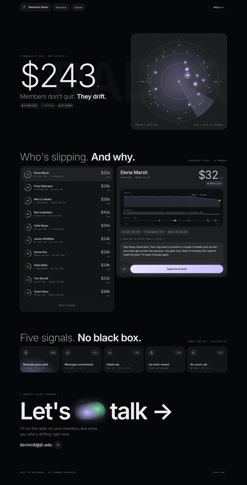
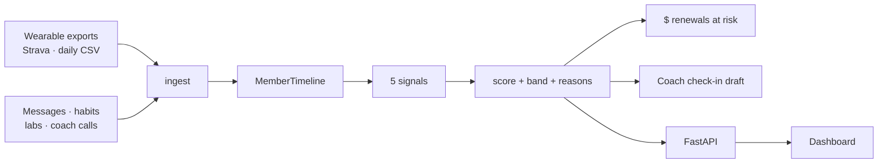
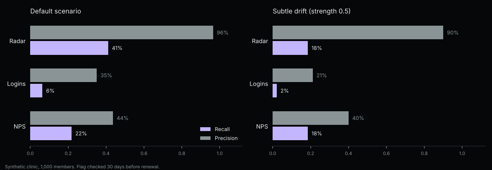
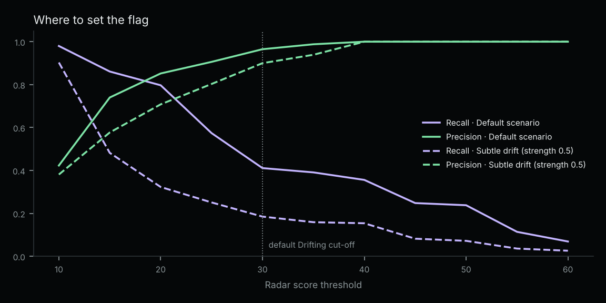

# Retention Radar

[](https://github.com/DrDanXD/retention-radar/actions/workflows/ci.yml)


**Early warning for member churn at longevity clinics.** Flags members who are drifting weeks before their renewal, explains why in plain language, and drafts a check-in in the coach's voice.

[Live demo](https://drdanxd.github.io/retention-radar/) · [The problem](docs/problem.md) · [Design notes](docs/design.md) · [Backtest](docs/backtest.md)



## The problem

Longevity clinics sell yearly memberships that cost from about $8,000 to over $85,000 [[1]](docs/problem.md#sources). The clinic sees each member only a few times a year. In between, members drift: the wearable goes in a drawer, coach messages go unread, habits slip, a lab draw gets skipped. By renewal time the decision is already made.

Clinics watch portal logins and NPS. Members keep logging in to read results while deciding to leave, and NPS is a sparse, lagging survey [[2]](docs/problem.md#sources). Neither looks at what members actually do day to day. [More on the problem](docs/problem.md).

## How it works



| Signal | Points |
|---|---|
| Wearable stops syncing 7+ / 14+ days | 15 / 30 |
| Coach messages unanswered 1 / 2+ | 8 / 20 |
| Habit adherence down 10+ / 25+ points | 10 / 20 |
| Missed lab draw | 15 |
| No coach call 60+ / 90+ days | 8 / 15 |

**Drifting** at 30. **Needs care** at 55. Every flag carries its reasons, so a coach knows exactly what to say. Why rules and not ML at clinic scale: [design notes](docs/design.md).

## Quick start

```bash
git clone https://github.com/DrDanXD/retention-radar
cd retention-radar
pip install -e ".[dev]"

radar sample                                   # write a synthetic clinic as CSV exports
radar score data/sample_clinic --as-of 2026-10-26
```

```
As of 2026-10-26: $222,000 in renewals at risk (7 of 42 members flagged)

   70  needs_care  Adrian Castellano       renews in  10d  $ 35,000  No sync 34d, 2 unanswered, Habits 70→44%
   58  needs_care  Rob Sato                renews in   6d  $ 14,000  No sync 29d, Habits 35→9%, 1 unanswered
   ...
```

More commands:

```bash
radar backtest --out docs        # compare against logins and NPS on 1,000 synthetic members
radar demo                       # rebuild the dashboard's docs/demo.json from the engine
radar serve data/sample_clinic   # HTTP API at http://127.0.0.1:8000/docs
pytest                           # 38 tests
```

Set `ANTHROPIC_API_KEY` to have Claude write the check-in drafts. Without it, a template is used and nothing leaves your machine.

## Backtest

On a synthetic clinic of 1,000 members, checked 30 days before renewal:

| Method | Precision | Recall | Members flagged | Median lead |
|---|---|---|---|---|
| **Radar** | **96%** | **41%** | 9% | 64 days |
| Portal logins | 35% | 6% | 4% | 71 days |
| NPS detractor | 44% | 22% | 10% | 120 days |



**Read this honestly:** the simulator assumes leavers change their daily behaviour before renewal. The run proves the pipeline works and shows how sensitive the method is to that assumption. When drift is half as strong, radar recall drops to 18%, level with NPS. It does not prove the assumption. That needs real clinic data. [Full write-up](docs/backtest.md).

The cut-off is a coach workload choice. Dropping it from 30 to 20 doubles recall to 80% at 85% precision, but flags twice as many members.



## Project layout

```
src/retention_radar/
  models.py       typed member timeline and risk assessment (Pydantic)
  config.py       every threshold and point value in one place
  signals.py      the five signals, each a pure function of (timeline, as_of)
  scoring.py      combine signals into score, band and revenue at risk
  ingest/         CSV clinic folder, Strava activities, daily wearable summaries
  drafts.py       coach check-in drafts via Claude, template fallback
  api.py          FastAPI service
  synth.py        synthetic clinic generator with ground truth
  backtest.py     evaluation against logins and NPS
  export.py       demo data for the dashboard
docs/             dashboard (GitHub Pages) and write-ups
tests/            pytest suite, run in CI on Python 3.11 to 3.13
```

## Data

No real member data is in this repo. Everything is simulated. How a pilot would handle protected health information: [data handling](docs/data-handling.md).

## Roadmap

- [ ] Pilot with one clinic on two years of de-identified history
- [ ] Oura and Whoop adapters, plus sleep as its own signal
- [ ] Calibrated model once there are enough real renewal outcomes
- [ ] Weekly at-risk digest for founders

## Run a longevity clinic?

I'm looking for a few clinics to pilot this on real data. Email **dsriniv8@jh.edu** or DM me on X.

Built by Dhiyanesh. MIT license.
